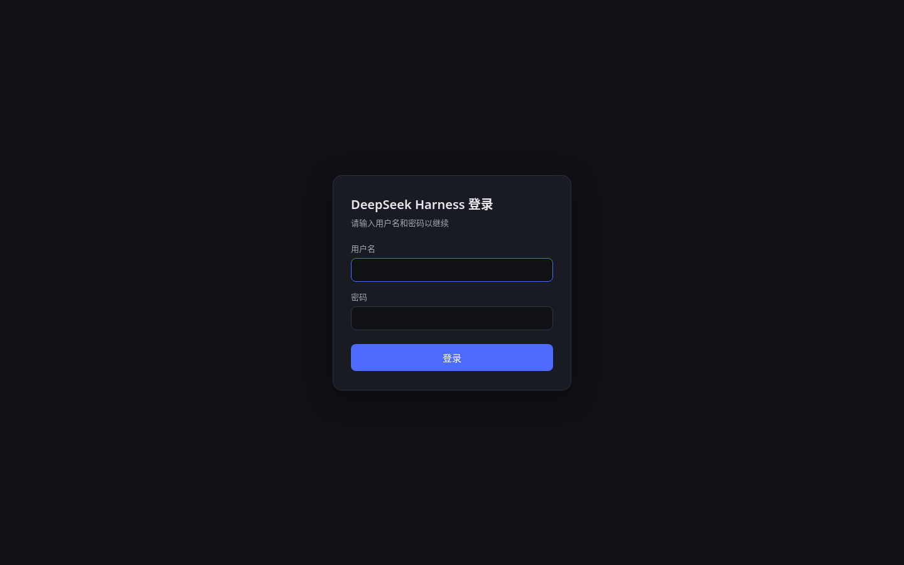
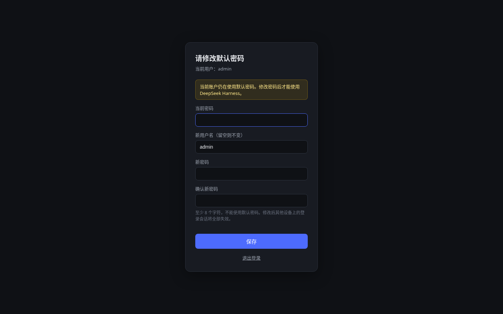
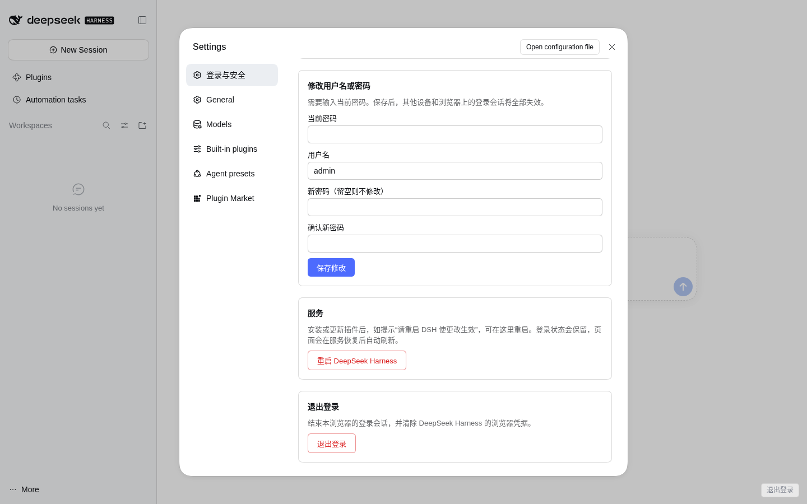
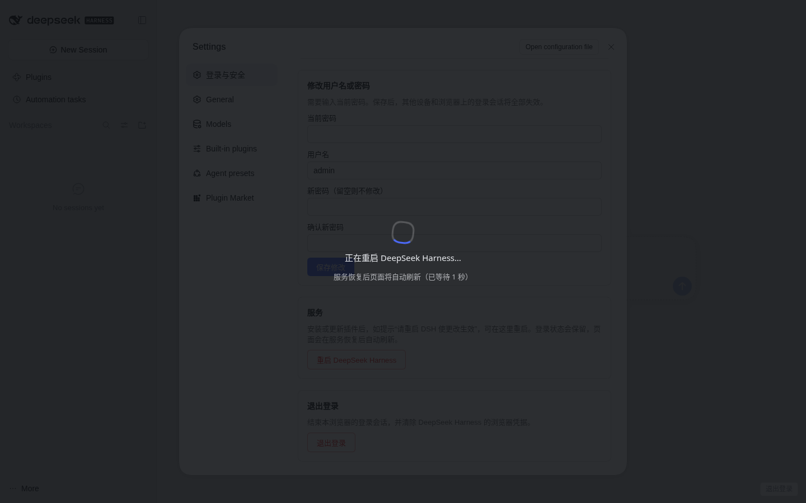

# dsh-auth

[English](README.md) | 中文

`dsh-auth` 是 [DeepSeek Harness](https://github.com/deepseek-ai/deepseek-harness)（`dsh`）的一个插件。它为 dsh **网页版（Web UI）**加上用户名/密码登录，让你可以把 `dsh web` 部署在服务器上（通常放在支持 HTTPS 的反向代理之后），而不必担心知道网址的人都能直接访问。

## 功能

- **登录 / 退出**：在 Web UI 前增加登录页。未登录访问 UI 会跳转到 `/_auth/login`，访问 `/api` 返回 `401`。退出时会同时清除 dsh-auth 会话和 dsh 自身的浏览器凭据。
- **账户设置**：在 **设置 → 登录与安全** 中原生集成，可修改用户名和密码，也可查看会话有效期并退出登录。修改密码后，其他设备上的登录会话全部失效。
- **强制修改默认密码**：首次安装使用默认账户 `admin` / `123456`。在修改密码之前，UI 和 `/api` 均被拦截，只显示修改密码页面。默认密码不能作为新密码。
- **防暴力破解**：同一客户端 IP 登录失败次数过多会被暂时锁定（默认 10 次 / 15 分钟）。
- **重启按钮**：在 **设置 → 登录与安全 → 服务 → 重启 DeepSeek Harness** 中可从网页重启 dsh。安装某些插件后，dsh 只会提示“请重启 DSH”，网页版本身无法重启。点击后会先弹出确认框，再显示“正在重启…”遮罩，等 dsh 恢复后自动刷新页面，登录状态保持不变。
- **支持反向代理**：仅信任来自本机回环地址的 `X-Forwarded-For` / `X-Forwarded-Proto`。Cookie 为 `HttpOnly`、`SameSite=Lax`，HTTPS 下自动加 `Secure`。

| 登录 | 强制修改密码 |
| --- | --- |
|  |  |

| 设置 → 登录与安全 | 重启中 |
| --- | --- |
|  |  |

## 环境要求

- DeepSeek Harness **0.2.1-rc.2**（已测试的版本；dsh 处于开发者预览阶段，插件 API 可能变化）
- Node.js **22**
- `pnpm`，`dsh plugin` 需要用到（`npm i -g pnpm@10`）
- 重启按钮需要 dsh 以 **systemd** 服务运行，或配置自定义的 `restartCommand`

## 安装

```sh
git clone https://github.com/werbenhu/dsh-auth.git
cd dsh-auth
npm install
npm run build            # 构建 lib/client.js（设置页面板）

dsh plugin --profile web add link:/path/to/dsh-auth
```

然后重启 dsh，例如执行 `systemctl restart <你的 dsh 服务>`，或者停止后重新运行 `dsh web`。

插件自带 bundle patch（`cordis.patch.yml`），负责挂载插件，并把 dsh 浏览器 Cookie 的有效期调整为与 7 天会话一致。profile 无需其他修改。

打开 Web UI，用 **`admin` / `123456`** 登录。系统会要求你先设置新密码（至少 8 位，且不能是 `123456`），之后才能使用 dsh。

## 配置

如需修改选项，在 profile 的 `cordis.patch.yml`（例如 `~/.dsh/profiles/web/cordis.patch.yml`）中添加 `dsh-auth` 行。未写的选项保持默认值：

```yaml
- id: dsh-auth
  config:
    stateDir: /home/me/.dsh-auth
    sessionDays: 30
```

| 选项 | 默认值 | 说明 |
| --- | --- | --- |
| `stateDir` | `/var/lib/dsh-auth` | 账户（`account.json`）、会话（`sessions.json`）和 `restart.log` 的存放目录。目录权限 `0700`，文件权限 `0600`。如果 dsh 不以 root 运行，请改为可写路径。 |
| `sessionDays` | `7` | 登录会话有效期（天）。 |
| `forcePasswordChange` | `true` | 修改默认密码之前拦截 UI 和 `/api`。 |
| `defaultUsername` | `admin` | 尚无账户时写入的用户名。 |
| `defaultPassword` | `123456` | 尚无账户时写入的密码。它永远不能作为新密码。 |
| `minPasswordLength` | `8` | 新密码最小长度。 |
| `lockoutMax` | `10` | 同一客户端 IP 被锁定前允许的登录失败次数。 |
| `lockoutMinutes` | `15` | 计数窗口和锁定时长（分钟）。 |
| `trustForwardedFor` | `true` | 使用 `X-Forwarded-For` / `X-Forwarded-Proto`，但仅限来自本机回环地址（反向代理）的请求。 |
| `logoutLink` | `true` | 在页面中注入一个悬浮的“退出登录”链接。 |
| `restart` | `true` | 启用重启按钮和 `POST /_auth/api/restart`。 |
| `restartUnit` | 自动 | 要重启的 systemd 服务，从 `/proc/self/cgroup` 自动检测（如 `dsh-web.service`）。 |
| `restartCommand` | — | 自定义重启命令（argv 数组），例如 `["supervisorctl", "restart", "dsh"]`，用来替代 `systemctl restart --no-block <unit>`。 |
| `distIndex` | 自动 | Web UI 的 `index.html` 路径，通常从已安装的 dsh 客户端中自动解析。 |

修改配置后需重启 dsh。

## 路由

| 路由 | 说明 |
| --- | --- |
| `GET/POST /_auth/login` | 登录页 |
| `GET/POST /_auth/logout`、`POST /_auth/api/logout` | 退出登录 |
| `GET/POST /_auth/account` | 强制修改密码页 |
| `GET /_auth/api/me` | 当前用户和会话信息（设置页使用） |
| `POST /_auth/api/account` | 修改用户名和密码（JSON，同源） |
| `POST /_auth/api/restart` | 重启 dsh。需要已登录、同源 JSON 请求，且没有待完成的强制改密。先返回 `202`，再执行重启。 |
| `GET /_auth/health` | 公开接口，返回 `{ ok, instance, startedAt }`。每次启动 `instance` 都会变化。 |

## 反向代理（nginx）

让 dsh 只监听本机，例如 `dsh web --no-open --host 127.0.0.1 --port 3080 --trusted-host your.domain`，再由 nginx 转发：

```nginx
# dsh 会拒绝跨站请求。用户从其他网站（聊天软件、邮件等）点击链接打开 UI 时，
# 浏览器发送 Sec-Fetch-Site: cross-site，dsh 会返回 403。
# 这里把跨站的顶层 GET/HEAD 导航视为直接访问（"none"），API、POST 和 WebSocket 保持原值。
map "$request_method:$http_sec_fetch_mode:$http_sec_fetch_site" $dsh_fetch_site {
    "~^(GET|HEAD):navigate:cross-site$" "none";
    default $http_sec_fetch_site;
}

map $http_upgrade $connection_upgrade {
    default upgrade;
    ''      close;
}

server {
    listen 443 ssl;
    server_name your.domain;
    # ssl_certificate / ssl_certificate_key ...

    location / {
        proxy_pass http://127.0.0.1:3080;
        proxy_http_version 1.1;

        # WebSocket（dsh 使用 /api/remote.mux）
        proxy_set_header Upgrade $http_upgrade;
        proxy_set_header Connection $connection_upgrade;

        proxy_set_header Host $host;
        proxy_set_header X-Forwarded-For $proxy_add_x_forwarded_for;
        proxy_set_header X-Forwarded-Proto $scheme;
        proxy_set_header Sec-Fetch-Site $dsh_fetch_site;

        # 流式响应与长连接
        proxy_buffering off;
        proxy_read_timeout 1d;
        proxy_send_timeout 1d;
    }
}
```

启动 dsh 时用 `--trusted-host` 传入你的公网域名，dsh 才会接受该 Host。

## 重置账户

忘记密码时，可在服务器上重置：

```sh
node bin/dsh-auth-reset.mjs [--state-dir /var/lib/dsh-auth] [--username admin] [--password 123456]
```

该命令会写入默认账户并开启强制改密，同时注销所有会话并更换签名密钥。之后重启 dsh，还可以清除锁定计数。

## 安全说明

- 密码使用 scrypt 哈希存储。会话 Cookie 经过 HMAC 签名，并与服务端会话列表比对，退出登录或修改密码都会使其失效。
- 会修改状态的接口要求同源请求，并且需要 JSON 请求类型或 CSRF 令牌。
- **请使用 HTTPS**，否则密码和 Cookie 会以明文传输。
- 锁定按客户端 IP 计算。`X-Forwarded-For` 只信任来自本机回环地址的请求。如果反向代理部署在其他主机，所有客户端都会显示为代理的 IP，共用同一个锁定计数。建议把代理和 dsh 部署在同一台机器上，或在代理层配合 fail2ban、限流。
- 重启接口以 dsh 进程的用户身份运行 `systemctl`，只能重启该用户有权限重启的服务。不需要此功能时可设置 `restart: false`。
- 请尽快修改默认密码。在修改之前，任何能访问到服务器的人都能用 `admin` / `123456` 登录并接管账户。

## 已知限制

- WebSocket（`/api/remote.mux`）和 dsh 的 channel 路由不经过 dsh-auth 的请求钩子，仅受 dsh 自身浏览器 Cookie 保护。该 Cookie 由 dsh-auth 在登录时签发、退出时清除。已签发的 Cookie 在有效期内（默认 7 天）仍然有效，即使 dsh-auth 会话已被注销，直到 dsh 轮换自身凭据为止。
- 仅支持单个账户，没有角色和双因素认证。
- 界面文字目前只有中文。

## 停用 / 卸载

- 只关闭重启按钮：设置 `restart: false`。
- 关闭强制改密：设置 `forcePasswordChange: false`。
- 卸载：

  ```sh
  dsh plugin --profile web remove dsh-auth
  ```

  删除你在 profile 的 `cordis.patch.yml` 中添加的 `id: dsh-auth` 行，重启 dsh，并可选择删除 `stateDir`。卸载后 dsh Web UI 会重新对所有能访问到它的人开放，请改用其他方式限制访问。

## 许可证

[MIT](LICENSE)
